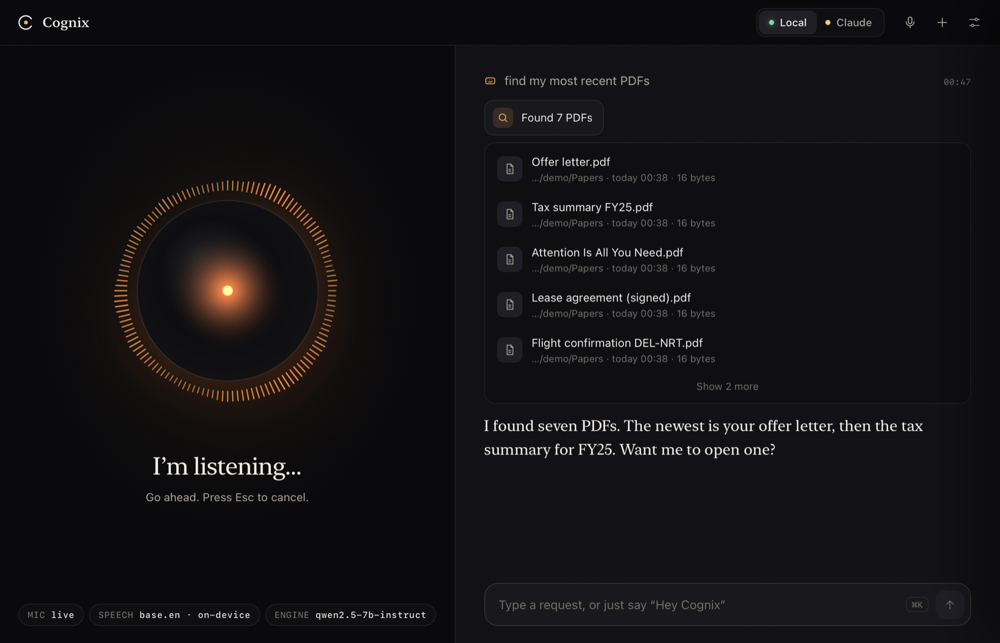

# Cognix

**A voice assistant that lives on your Mac.** Say *"Hey Cognix"* and ask it to open an app, find a file, read a PDF, change the volume or look something up. It is always listening, and it does that listening privately, on your own machine.



- **Hands-free.** No button to press. Cognix wakes when it hears "Hey Cognix" and goes back to sleep when you are done.
- **Private by default.** Speech is recognised on-device with Whisper. Anything that does not start with the wake phrase is thrown away without being shown, saved or sent anywhere.
- **Two brains.** *Local* runs entirely offline through [LM Studio](https://lmstudio.ai). *Claude* uses the Claude API for harder questions and live web search. Switch with one click.
- **It actually does things.** Opens and quits apps, finds files with Spotlight, opens and reads PDFs and Word documents, controls volume and music, takes screenshots, runs your Shortcuts.
- **Safe to leave running.** It cannot delete, move or edit your files, and it cannot run shell commands.

## Quick start

You need a Mac and Python 3.10 or newer.

```bash
git clone https://github.com/Rohansinha2003/Cognix_Agent.git
cd Cognix_Agent
./run.sh
```

The first run sets up a virtual environment and downloads the speech model (about 150 MB, once). macOS will ask to let your terminal use the microphone. Allow it, then say:

> **"Hey Cognix, open Safari."**

Simple commands like that one work straight away, with no model connected. For everything else, pick an engine:

| Engine | Setup |
|---|---|
| **Local** | Use [Bionic](https://lmstudio.ai) or LM Studio (same engine) with a model that supports tool use (Qwen 2.5, Llama 3.1 and similar). Cognix reads Bionic's server settings, probes the usual ports (1234, Ollama's 11434, 8080, 1337, 8000), switches to whichever server is up, and starts Bionic's server for you if it isn't running. Turn this off with *Auto-detect* in Settings. |
| **Claude** | Open Settings (⌘,), paste an [Anthropic API key](https://console.anthropic.com/) and choose Claude in the top bar. The key is stored in your macOS Keychain. |

## Things to say

| Say | What happens |
|---|---|
| "Hey Cognix, open my most recent PDF" | Finds it with Spotlight and opens it in Preview |
| "…find the file called resume" | Lists matches; click one to open it, or *Reveal* to show it in Finder |
| "…what's in my Downloads folder?" | Lists the newest items |
| "…summarise the lease agreement PDF" | Finds the file, reads it and tells you what it says |
| "…open VS Code" / "…quit Calculator" | Launches or quits the app |
| "…turn the volume down" / "…mute" / "…next song" | Controls sound and playback |
| "…take a screenshot" | Saves one to your Desktop |
| "…search the web for flights to Tokyo" | Opens the results in your browser |
| "…what's the latest on the Mars mission?" | Claude searches the web and answers (Claude engine) |
| "…run my Morning shortcut" | Runs a shortcut from the Shortcuts app |

You can also say just "Hey Cognix", wait for the chime, then speak. Or type in the box. **Esc** stops Cognix mid-sentence.

## How it works

```
 microphone ──► endpointing ──► Whisper (on-device) ──► wake phrase? ──no──► discarded
                                                              │ yes
                                                              ▼
                      instant commands ◄── request ──► Local (LM Studio)  or  Claude API
                              │                                │
                              └──────────► tools ◄─────────────┘
                                   apps · files · PDFs · volume · …
                                             │
                                  reply shown and spoken aloud
```

| File | Role |
|---|---|
| `cognix/listener.py` | Microphone capture and utterance detection |
| `cognix/stt.py` | Speech-to-text with faster-whisper |
| `cognix/wake.py` | Wake-phrase matching that tolerates mis-hearings ("Cognics", "Kognix") and rejects look-alikes ("cognac") |
| `cognix/brain.py` | The two engines: Claude (streaming, tool use, web search) and any OpenAI-compatible local server |
| `cognix/tools.py` | The tool catalogue, argument validation and instant commands |
| `cognix/mac.py` | The macOS actions themselves |
| `cognix/assistant.py` | The conductor that ties it all together |
| `cognix/speech.py` | Text-to-speech with the built-in macOS voices |
| `cognix/server.py` | Local server behind the window |
| `cognix/web/` | The interface: plain HTML, CSS and JavaScript, no build step |

### Adding a tool

Write a function in `cognix/mac.py` that returns a `ToolResult`, then describe it in the `TOOLS` list in `cognix/tools.py`. Both engines pick it up automatically.

## Privacy and security

- **Audio** is transcribed on your Mac and never stored. Only speech that begins with the wake phrase becomes a request.
- **Local engine:** nothing leaves your machine.
- **Claude engine:** your request, and the contents of any file you ask Cognix to read, are sent to Anthropic.
- **No destructive tools.** Cognix cannot delete, move, rename or edit files, send messages or run shell commands. It refuses to read credential files (`~/.ssh`, `.env`, key files).
- **The interface is local-only.** It listens on `127.0.0.1`, requires a random per-launch token for every command, and rejects requests with a foreign `Host` header, so a web page cannot drive your Mac through it.
- **History** of requests and replies is kept in `~/.cognix/history.jsonl`. Turn it off in Settings.

## Settings

Open with **⌘,**. Everything is saved to `~/.cognix/config.json`.

- Engine, local server address and model, Claude model, web search on or off
- Wake-phrase listening, follow-up questions without the wake phrase, wake chime
- Speech recognition model (`tiny.en` is fastest, `small.en` is most accurate, `base` and `small` are multilingual)
- Spoken replies, voice and speed

Command-line options: `./run.sh --browser` opens the interface in your browser instead of a window, and `--port` fixes the port.

## Troubleshooting

| Problem | Fix |
|---|---|
| The **Mic** chip says "no access" | System Settings → Privacy & Security → Microphone → enable your terminal, then restart Cognix |
| It does not react to "Hey Cognix" | Watch the ring: it should move when you speak. If it does but nothing wakes, try the `small.en` speech model in Settings |
| You plugged in a different microphone | Cognix keeps the one it started with. Click the mic button off and on to switch |
| "The local model server isn't reachable" | Open Bionic, load a model and start the server from its Developer tab. If Bionic won't open at all, reinstall it (macOS may report its signature as broken) |
| The local model never uses tools | Choose a model trained for tool use; small models often answer in text only |
| Quitting apps, dark mode or music control fails | Allow the prompt macOS shows, or enable it under Privacy & Security → Automation |
| No sound | Check your Mac's volume and that *Speak replies* is on |

## Development

```bash
.venv/bin/python -m unittest            # 63 tests, about 30 seconds
.venv/bin/python tests/fake_llm.py 1234 # a scripted stand-in for LM Studio
```

The tests drive the real pipeline: synthesized speech goes through endpointing, Whisper and wake matching, and the Claude engine runs through the real Anthropic SDK against a local mock of the API. No microphone, speaker, network or API key is used.

Contributions are welcome. Linux and Windows support mostly means a second implementation of `cognix/mac.py`.

## License

MIT
